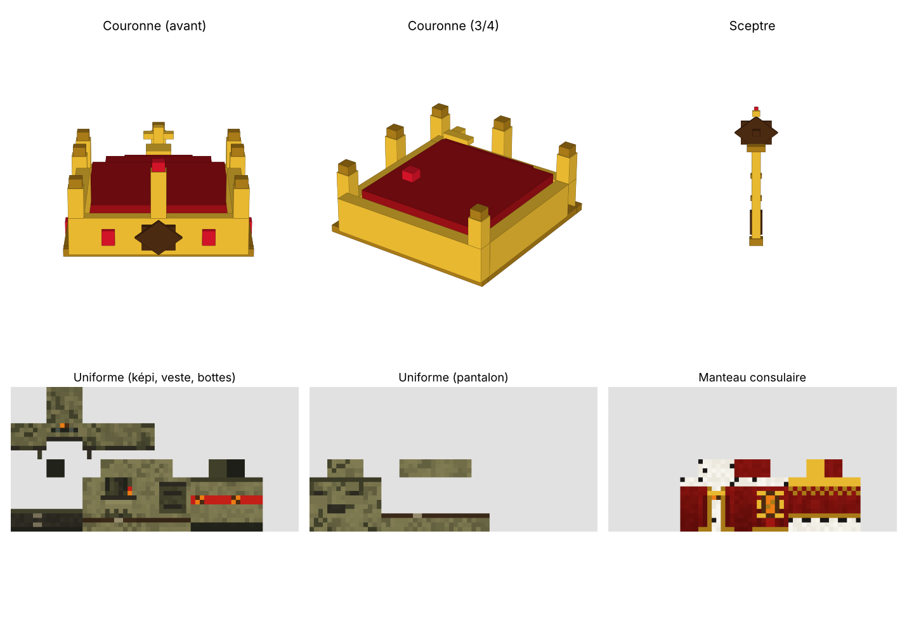
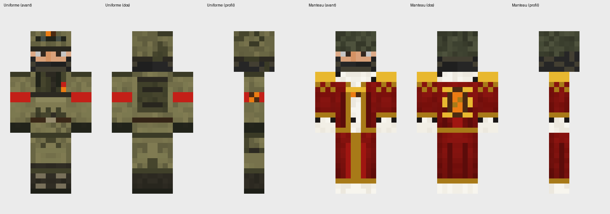

# Resource pack de l'Empire Consulaire de Wôzorfôz

Resource pack serveur (Minecraft Java 1.21.9) : objets cérémoniels et uniforme de la Garde.





## Contenu

| Objet | Modèle | Porté sur |
| --- | --- | --- |
| Couronne Consulaire | 3D (`wozorfoz:couronne`) | Tête |
| Sceptre Consulaire | 3D (`wozorfoz:sceptre`) | Main |
| Manteau Consulaire : haut et pans | Texture d'équipement (`wozorfoz:manteau`) : velours ombré, plis, hermine, broderie de l'engrenage dans le dos | Torse, jambes |
| Uniforme de la Garde : casque, gilet tactique, treillis, bottes | Texture d'équipement (`wozorfoz:uniforme`) : camouflage olive, poches, brassard impérial | Tête, torse, jambes, pieds |

Les objets se donnent avec le datapack `wz_drapeau` :
`/function wz_drapeau:objets_consulaires` et `/function wz_drapeau:objets_uniforme`.

## Installation sur le serveur

Chaque modification poussée sur `main` dans le dossier `pack/` crée automatiquement une nouvelle version (onglet *Releases*).

Dans `server.properties` :

```properties
resource-pack=https://github.com/Koraneii/wozorfoz-resourcepack/releases/latest/download/wozorfoz_resourcepack.zip
require-resource-pack=true
```

Ce lien pointe toujours vers la dernière version. Si vous renseignez aussi `resource-pack-sha1`, recopiez le SHA-1 indiqué dans la release à chaque nouvelle version (sinon les joueurs gardent l'ancienne en cache). Laisser `resource-pack-sha1` vide est plus simple : le pack est alors retéléchargé à chaque connexion (il est léger).

## Structure

```
pack/
├── pack.mcmeta, pack.png
└── assets/wozorfoz/
    ├── items/                       définitions d'objets (1.21.4+)
    ├── models/item/                 couronne et sceptre 3D, icônes
    ├── equipment/                   uniforme et manteau
    └── textures/
        ├── item/                    palette des modèles 3D, icônes
        └── entity/equipment/        textures portées (64×32)
```

Les modèles 3D utilisent une palette de couleurs (`textures/item/palette.png`) : chaque face pointe vers une case de couleur.
